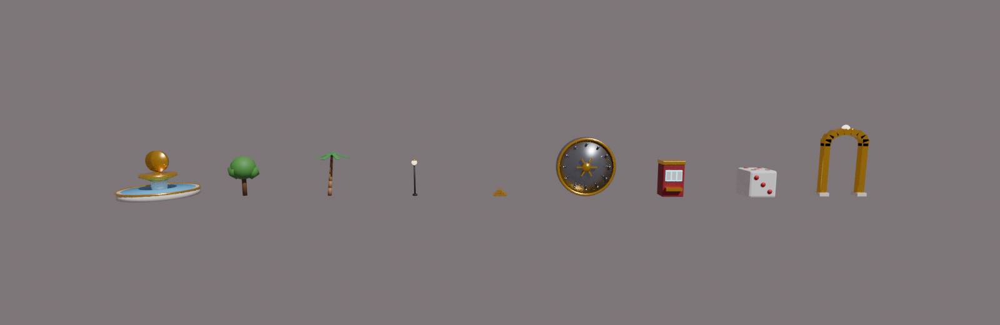

# Blender models

`blender/build_models.py` builds 9 low-poly luxury props and exports them as FBX:

| Prop (Model name) | Used for | Triangles |
|---|---|---|
| `Fountain` | Spawn plaza centrepiece | ~1.5k |
| `Tree` | Avenues, zone islands | ~160 |
| `PalmTree` | Mansion estate | ~270 |
| `Lamp` | Street lamps | ~850 |
| `GoldBars` | Vault room | ~650 |
| `VaultDoor` | Vault room | ~1.3k |
| `SlotMachine` | Upgrade machines on the Neon Strip | ~400 |
| `Dice` | Neon Strip decoration | ~590 |
| `PortalArch` | Zone portals | ~430 |



## Regenerate or edit

```bash
# with Blender installed
blender --background --python blender/build_models.py
# or with the bpy module (pip install bpy, Python 3.11)
python blender/build_models.py
```

This writes `assets/models/<Prop>.fbx`, `Props.blend` (the editable scene) and `preview.png`.

To edit a prop by hand, open `assets/models/Props.blend`. Each prop is a collection. Select a collection's objects and use *File → Export → FBX* with **Selected Objects**, **Forward −Z** and **Up Y**.

**Naming rule:** name every mesh `<Palette>_<Part>`, for example `Gold_Bowl` or `Marble_Basin`. The game uses the prefix to apply the right colour and Roblox material after import, even if the importer drops material colours. The palette names are Gold, Marble, Dark, Water, Leaf, Palm, Wood, Bark, Steel, Red, White, Pip, Glow and Neon. `Glow_` parts also get a light.

## Import into Roblox Studio

1. Open the place, then go to *Home → Import 3D* (the 3D Importer).
2. Pick a file such as `Lamp.fbx`. In the importer, keep **Import as Model** on and leave the scale as-is. The game rescales every prop to fit its spot automatically.
3. After import, rename the model so it **exactly matches the prop name** (`Lamp`, `Fountain` and so on).
4. Move the model into **ServerStorage → Models**.
5. Press Play. Every place that would have built the part version of that prop now uses your mesh instead, anchored, scaled and recoloured.

Props you don't import keep using the code-built part versions, so you can import them one at a time.

## Making your own props

Add a function to `PROPS` in `build_models.py`, export it, and import it under a new name. Then call `placeProp(parent, "<Name>", cframe, footprintStuds, fallbackFn)` in `src/server/Map/MapService.luau` where you want it placed.
